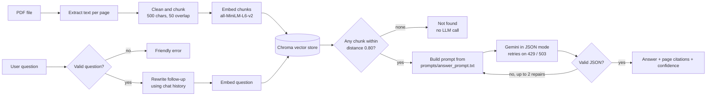

# PDF RAG Assistant (Week 4)

[](https://colab.research.google.com/github/bezawitlegesse/AWS_Ai_ml-week-04/blob/main/notebooks/demo.ipynb)

AI/ML AWS AASTU Cohort, Week 4 (Generative AI and AI Applications).

A command-line and Colab assistant that answers questions about a **PDF** using **Retrieval-Augmented Generation (RAG)**. It finds the passages of the PDF that match a question, gives only those passages to a Gemini model, and returns an answer as **validated JSON with page citations**. If the PDF does not contain the answer, it says so instead of inventing one.

## What it does

```text
You:     What is an identity matrix?
Answer:  The identity matrix is a square matrix with 1 on the main diagonal and 0 everywhere else.
Pages:   2        Confidence: high
```

Every answer is a JSON object checked against a schema before it is shown:

```json
{
  "answer": "<short answer>",
  "found": true,
  "citations": [2],
  "confidence": "high"
}
```

## How this project meets the Week 4 requirements

| Requirement | Where it is done |
|---|---|
| Working end-to-end pipeline | `rag/pipeline.py` (PDF → chunks → embeddings → Chroma → Gemini → validated answer) |
| Prompt in a file | `prompts/answer_prompt.txt`, `rewrite_prompt.txt`, `repair_prompt.txt`, `judge_prompt.txt` |
| Structured output + validation | `rag/schemas.py` checks the JSON; invalid replies are repaired (up to 2 retries with the error message) |
| Basic evaluation (golden tests) | `eval/golden_set.json` (21 cases) and `eval/run_eval.py`, which writes `eval/results/report.md` |
| Error handling and retries | `rag/retry.py` (waits 1 s, 2 s, 4 s on 429/503/timeouts), input checks, "not found" answers, friendly API error messages in `rag/llm.py` |
| Keys in environment variables | `GEMINI_API_KEY` in `.env` or Colab Secrets; `.env` is in `.gitignore` |
| Runs from a clean checkout | see **Setup and run** below; a sample PDF is included in `data/` |
| Tests | 34 offline unit tests in `tests/` (no API key needed) |

## Architecture



1. **Load:** `pypdf` reads each page; the text is cleaned (broken lines, hyphenated words).
2. **Chunk:** each page is cut into 500-character chunks that overlap by 50 characters. Every chunk remembers its page number.
3. **Embed and store:** `all-MiniLM-L6-v2` turns each chunk into 384 numbers; the vectors go into a ChromaDB collection that uses cosine distance.
4. **Retrieve:** the question is embedded and the 3 closest chunks are fetched. A chunk farther than **0.80** is treated as not relevant. If none is close enough, the app answers "not found" without calling the LLM.
5. **Generate:** the chunks, the question and the rules are rendered into the answer prompt and sent to Gemini in JSON mode.
6. **Validate:** the reply must be valid JSON with the right fields, and every cited page must be one of the retrieved pages. If not, the model is asked again with the exact error (up to 2 repairs).
7. **Memory:** a follow-up such as "What happens when I multiply another matrix by it?" is first rewritten into a standalone question using the last 6 turns.

## Project structure

```text
.
├── app.py                  # command-line chat
├── rag/
│   ├── config.py           # chunk size, top_k, distance threshold, model names
│   ├── pdf_loader.py       # read, clean and chunk the PDF
│   ├── embedder.py         # sentence-transformers embeddings
│   ├── vector_store.py     # ChromaStore (app) and InMemoryStore (tests)
│   ├── prompts.py          # loads prompts/*.txt and fills the placeholders
│   ├── schemas.py          # JSON answer validation
│   ├── retry.py            # retry with growing waits
│   ├── llm.py              # Gemini client and friendly error messages
│   ├── pipeline.py         # RAGAssistant and ChatSession
│   └── factory.py          # builds the real assistant
├── prompts/                # all prompts, as text files
├── data/matrix_basics.pdf  # sample 6-page study guide (original text)
├── eval/                   # golden_set.json, run_eval.py, results/
├── tests/                  # offline unit tests with fake LLM and embedder
├── scripts/make_sample_pdf.py
├── notebooks/demo.ipynb    # Colab walkthrough
├── requirements.txt
└── .env.example
```

## Setup and run

### Option A: Google Colab

1. Click the **Open in Colab** badge above.
2. Add your key to **Colab Secrets** with the name `GEMINI_API_KEY` and turn on notebook access.
3. Choose **Runtime > Run all**.

### Option B: On your computer (clean checkout)

```bash
git clone https://github.com/bezawitlegesse/AWS_Ai_ml-week-04.git
cd AWS_Ai_ml-week-04

python -m venv .venv
# Windows:
.venv\Scripts\activate
# macOS / Linux:
source .venv/bin/activate

pip install -r requirements.txt

cp .env.example .env        # then open .env and paste your own Gemini API key
```

Get a free key from Google AI Studio. The key is read from the `GEMINI_API_KEY` environment variable (or `.env`) and is never stored in the code or in Git.

```bash
python app.py                                    # chat with the sample PDF
python app.py --pdf path/to/your.pdf             # chat with your own text-based PDF
python app.py -q "What is an identity matrix?"   # ask one question
python app.py -q "What is a matrix?" --json      # show the full result as JSON
python app.py --list-models                      # models your key can use

python -m eval.run_eval                          # run the golden tests (writes eval/results/report.md)
python -m eval.run_eval --retrieval-only         # test retrieval only (no API key needed)
python -m unittest discover -s tests -t .        # unit tests (offline)
```

The first run downloads the embedding model (about 90 MB).

## Prompt design choices

- **Prompts are files.** They can be read, changed and compared in Git without touching the code. Placeholders such as `<<CONTEXT>>` are filled in a single pass, so text coming from the PDF can never inject another placeholder.
- **"Use ONLY the context."** Stops the model from answering from memory, which is the main cause of hallucinations in RAG.
- **The context is untrusted data.** A PDF can contain text such as "ignore the rules". The prompt tells the model to treat it as data, not as instructions.
- **An exact refusal sentence** ("I could not find that in the document.") plus `found: false` makes a refusal easy to detect and to test.
- **Two examples (few-shot)**, one answered and one refused, show the model the exact JSON format and when to refuse.
- **Citations as page numbers.** The pages are checked in code against the retrieved pages, so the model cannot cite a page it was not given.
- **Low temperature (0.2)** keeps answers stable between runs.
- **A confidence field** with a definition for each level.
- **A separate rewrite prompt** for follow-up questions, and a **repair prompt** that shows the model its previous invalid reply and the exact problem.

## Evaluation

`eval/golden_set.json` contains 21 test cases written for the sample PDF:

- **15 answerable questions**, each with expected keywords and the page that holds the answer (one is a follow-up question that needs memory)
- **4 questions the PDF cannot answer** (for example "Who painted the Mona Lisa?"), which must be refused
- **2 prompt-injection attacks**, which must be refused without leaking the rules

`python -m eval.run_eval` measures:

| Metric | Meaning |
|---|---|
| Retrieval hit rate | the expected page is among the retrieved chunks |
| Keyword score | share of the expected keywords found in the answer |
| Citation accuracy | the expected page is cited |
| Refusal / injection pass rate | out-of-document and attack questions are refused, nothing leaks |
| JSON valid on first try | how often no repair was needed |
| Average latency | seconds per question |
| LLM judge (`--judge`, optional) | faithfulness and relevance scored 1 to 5 by Gemini |

A case passes when the answer is found, has at least half of the expected keywords and cites the right page (answerable questions), or when the assistant refuses and leaks nothing (everything else). The runner writes `eval/results/report.md`, which also lists the failed cases.

### Results from my run

> **TODO after your first run:** open `eval/results/report.md`, copy the numbers into the table below, and copy 2 good and 1 to 2 bad answers from the report into the examples. Then delete this note.

| Metric | Result |
|---|---|
| Overall pass rate | __ |
| Retrieval hit rate | __ |
| Citation accuracy | __ |
| Refusals / injection tests passed | __ |
| JSON valid on the first try | __ |

**Good output:** (question, answer, pages)

**Bad output and why it failed:** (question, answer, your explanation)

## Limitations and responsible AI

- **It can still be wrong.** The answer is only as good as the retrieved chunks. A chunk can cut a formula in half, and a wrong chunk can lead to a wrong answer. The page citations let a reader check the source.
- **Prompt injection is reduced, not solved.** The prompt rules, the input length limit and the schema check help, but no prompt wording stops every attack.
- **Text-based PDFs only.** Scanned PDFs have no text to extract (OCR would be needed).
- **Tuning.** `max_distance = 0.80`, `top_k = 3` and the chunk size were chosen as sensible starting points and should be tuned for other documents. Too strict a threshold refuses answerable questions.
- **English-focused.** The embedding model works best on English text.
- **Crude keyword check.** The eval counts keywords, so a correct answer in different words can fail it. The optional LLM judge helps, but a model grading a model has its own bias.
- **Privacy.** Retrieved text and questions are sent to Google's Gemini API. Do not use confidential documents.
- **Copyright.** The included PDF is original text written for this project. Do not commit copyrighted PDFs to a public repository.
- **Secrets.** The API key lives only in `.env` or Colab Secrets. `.env` is git-ignored; `.env.example` shows the format.
- **Not an authority.** It is a study aid. Answers should be checked against the source before being relied on.

## Troubleshooting

| Problem | What to do |
|---|---|
| `404` or "model not found" | Run `python app.py --list-models`, then set `GEMINI_MODEL` to a listed name |
| `401` / `403` or "API key rejected" | Check `GEMINI_API_KEY` in `.env` or Colab Secrets |
| `429` or quota reached | Wait a minute; the app already retries with growing waits. Use `--delay 3` in the eval |
| "No text could be extracted" | The PDF is scanned images; use a text-based PDF |

## Credits

Built with `pypdf`, `sentence-transformers`, `chromadb` and the `google-genai` SDK. The overall RAG approach follows the Week 4 lecture and the instructor's example notebook; the code, prompts, tests and evaluation here are my own.
